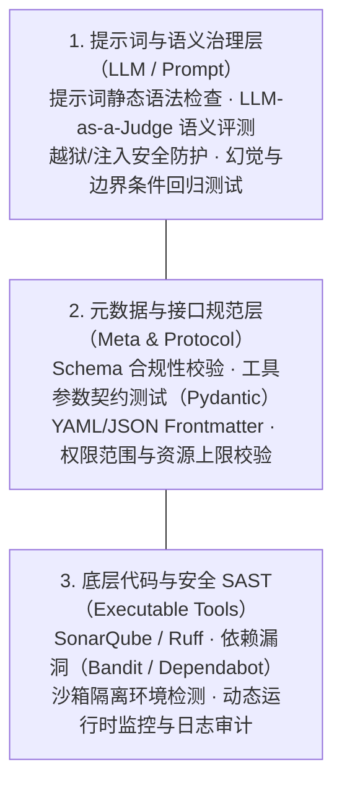

针对 Agent Skill 的工程化检查，业界目前普遍采用“三层防护 + 自动化流水线”的架构。由于 Agent Skill 兼具“自然语言提示词”、“结构化配置文件”和“底层可执行代码”三种属性，单一的静态代码扫描工具（如 SonarQube）无法覆盖全部风险，需要按层分工治理。

---

### 一、 Agent Skill 标准工程化检查体系

#### 1. 结构与元数据校验 (Linting & Schema Validation)

在 CI/CD 流水线的最前端，对 Skill 的静态资源进行“零成本”快速过滤。

* **YAML/JSON Frontmatter 校验**：使用 JSON Schema 或 Pydantic 校验 Skill 的描述文件（如 `SKILL.md` 的 Frontmatter 头部），确保 `name`、`description`、`parameters` 等基础字段定义符合规范。
* **接口契约校验**：对 Skill 暴露给 Agent 的 Tool 接口参数类型（如 Type Hints）进行严格检查，防止由于参数定义模糊导致 Agent 调度失败。

#### 2. 底层代码与安全 SAST (Code Quality & Security)

针对 Skill 所调用的实际可执行脚本（Python、Shell、Node.js 等）。

* **静态代码分析**：利用 **SonarQube**、**Ruff** 或 **Flake8** 检查代码质量、逻辑漏洞及圈复杂度。
* **安全漏洞扫描**：使用 **Bandit**（针对 Python 安全）、**Semgrep** 或 **SonarQube SAST**，重点拦截：
* **命令注入**：如任意 Shell 命令执行。
* **路径遍历**：如突破沙箱目录读取敏感文件。
* **凭证泄露**：硬编码 API Key 或敏感信息。

#### 3. 提示词质量与安全治理 (Prompt Engineering & Red Teaming)

针对自然语言提示词（Prompt）与 Agent 行为的专属检查，通常在模拟环境或 CI 流水线中进行。

* **Prompt Linting**：检查 Prompt 是否包含过长的无效上下文、模糊指引或冲突指令。
* **提示词注入防护 (Prompt Injection & Jailbreak)**：使用 **rebuff**、**garak** 或内部红队测试集，模拟恶意输入，验证 Skill 提示词是否会被越狱或提权。
* **LLM-as-a-Judge 单元测试**：使用固定测试集（Golden Dataset）调用高阶模型或专有评估模型，对 Skill 的输出质量、遵循度、格式规范及幻觉率进行自动化打分。

#### 4. 沙箱与运行时安全限制 (Runtime Defense)

在隔离环境对 Skill 的运行行为进行兜底。

* **网络与文件系统隔离**：确保 Skill 关联的代码运行在 Docker/gVisor 或 Linux cgroups 隔离沙箱中。
* **权限极小化**：限制 Skill 运行时的环境变量访问权限、外网请求域名白名单以及 CPU/内存耗尽限制。

---

### 二、 典型 CI/CD 流水线集成方案

在实际研发交付中，Skill 的自动化检查通常编排进如下流水线：

| 阶段 | 自动化检查任务 | 常用工具 | 门禁标准 (Gate) |
| --- | --- | --- | --- |
| **Lint & Commit** | Schema 语法校验、代码格式检查 | Markdownlint, Pre-commit, Ruff | 语法 0 Error |
| **Build & SAST** | 结构化逻辑扫描、代码安全分析 | SonarQube, Bandit, Semgrep | 无 High/Critical 级漏洞 |
| **Eval & Test** | 提示词安全性测试、语义单元测试 | Garak, Promptfoo, LLM-Eval | 注入测试 pass rate = 100% |
| **Deploy Gate** | 运行时沙箱配置校验、合规审计日志校验 | Docker, Open Policy Agent (OPA) | 镜像/策略合规 |